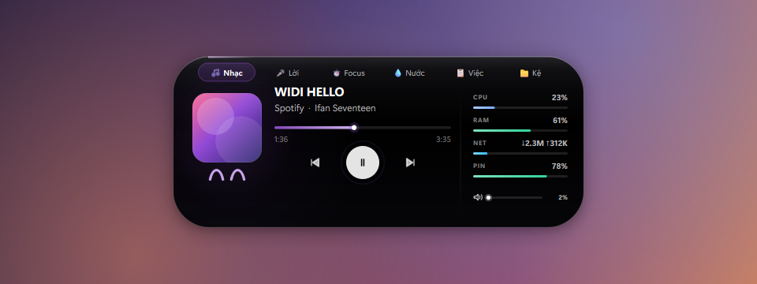
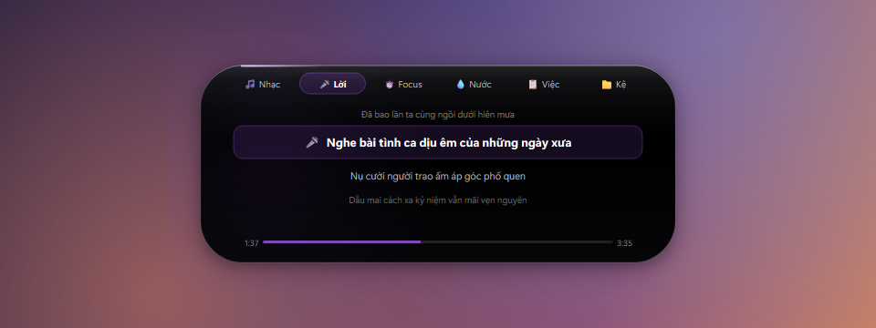
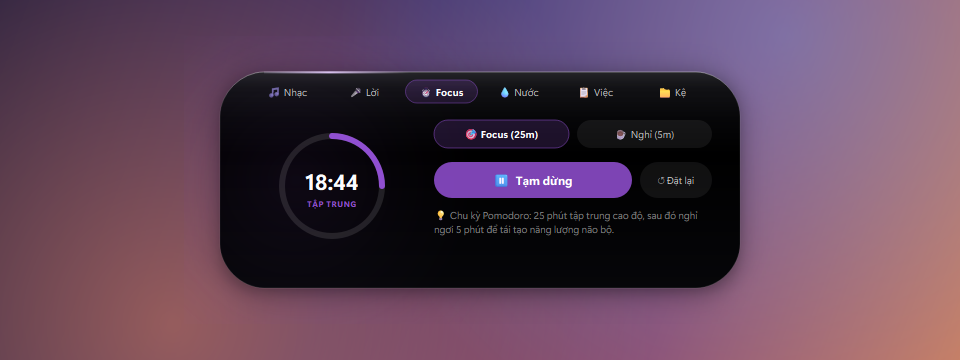
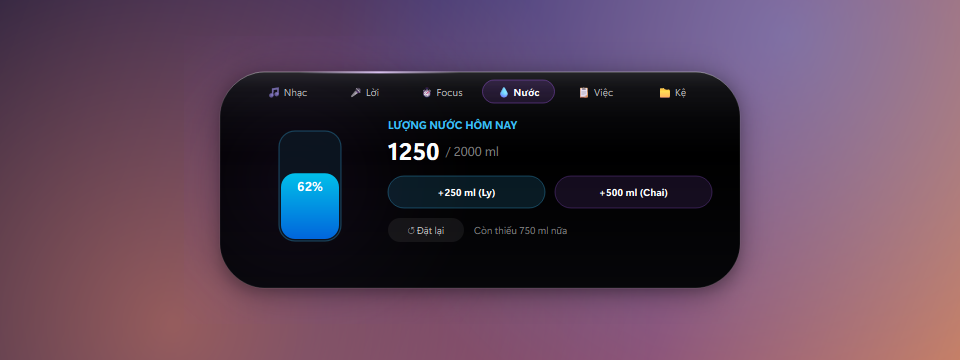
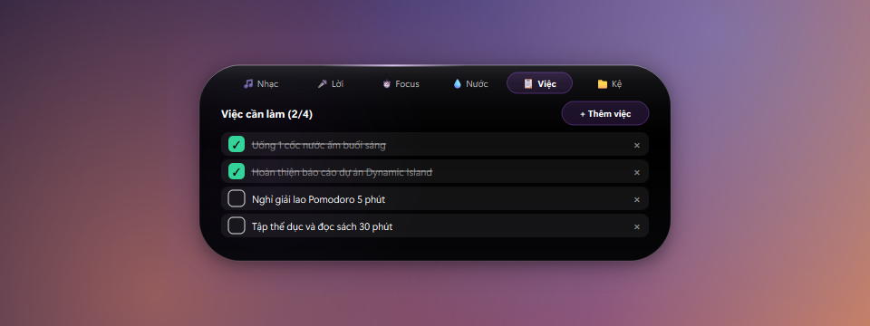
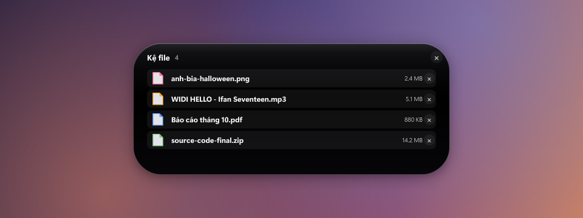
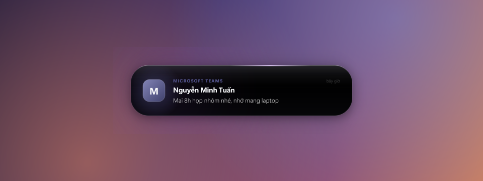

# Dynamic Island cho Windows (Nusa Edition) 🏝️

Viên đảo tương tác thông minh phong cách **Apple Dynamic Island** kết hợp trọn vẹn bộ công cụ năng suất của **Nusa** (The Living Notch for Windows): Nhạc & Lời bài hát đồng bộ (Synced Lyrics), Focus Pomodoro Timer, Theo dõi uống nước, Việc cần làm (To-Do), Kệ lưu file tạm (Shelf), và Phản hồi phần cứng Caps Lock.

Toàn bộ code chạy hoàn toàn local trên máy tính của bạn — bảo mật, không gọi mạng ngoại trừ API lấy lời bài hát miễn phí, không service ngầm nặng nề.

---

## 📸 Bộ Giao Diện & Tính Năng Phong Cách Nusa

| 🎵 Tab Nhạc (Music & Sys Stats) | 🎤 Tab Lời bài hát đồng bộ (Synced Lyrics) |
|---|---|
|  |  |

| ⏱️ Tab Tập trung (Pomodoro Timer) | 💧 Tab Theo dõi uống nước (Water Tracker) |
|---|---|
|  |  |

| 📋 Tab Việc cần làm (To-Do Checklist) | ⇪ Hardware HUD: Caps Lock Overlay |
|---|---|
|  |  |

| 📁 Kệ file kéo-thả (File Shelf) | 🔔 Thông báo Windows thông minh |
|---|---|
|  |  |

| 💤 Thu gọn — rảnh rỗi (Ngủ lim dim) | ⚡ Thu gọn — đang phát nhạc |
|---|---|
|  |  |

---

## 🌟 Tính Năng Đặc Trưng Chuẩn Nusa & Apple Dynamic Island

### 1. 🎛️ Thanh Điều Hướng Widget Mở Rộng (Nusa Navigation Tabs)
Khi rê chuột hoặc ghim mở rộng, Dynamic Island xuất hiện thanh 6 Tab tinh tế ở đỉnh:
- **🎵 Nhạc**: Trình phát nhạc SMTC, ảnh bìa có quầng sáng ambient backlight, thanh tua bài hát (click/kéo để seek), sóng nhạc Apple Music, bảng thông số CPU/RAM/NET/PIN và thanh trượt âm lượng hệ thống.
- **🎤 Lời**: Lời bài hát đồng bộ thời gian thực chuẩn Apple Music lấy tự động từ **LRCLIB API** miễn phí. Câu đang hát được phóng to, sáng rực rỡ kèm huy hiệu micro 🎤. **Đặc biệt: Click vào bất kỳ câu hát nào để tua bài hát ngay lập tức đến đoạn đó!**
- **⏱️ Focus**: Đồng hồ Pomodoro 25 phút tập trung / 5 phút nghỉ ngơi với vòng tròn tiến độ mềm mại. Đếm ngược thời gian thực, có nút Bắt đầu / Tạm dừng / Đặt lại / Chuyển chế độ và tự động gửi thông báo khi hết giờ.
- **💧 Nước**: Bộ theo dõi lượng nước uống trong ngày với ly nước thuỷ tinh trực quan dâng theo % thực tế. Nút thêm nhanh `+250 ml (Ly)` và `+500 ml (Chai)`, tự động lưu và đặt lại mỗi ngày mới.
- **📋 Việc**: Danh sách ghi chú việc cần làm nhanh (Checklist). Tích chọn đánh dấu hoàn thành (gạch ngang chữ), thêm việc mới nhanh qua nút `+ Thêm việc`, xoá việc cũ, tự động lưu trữ lâu dài.
- **📁 Kệ**: Kệ lưu file tạm thời. Kéo thả file từ Explorer vào để lưu; click mở nhanh bằng ứng dụng mặc định; kéo ngược chip file thả vào Telegram, Discord, Zalo, Outlook; xoá file; cuộn mượt khi có nhiều file.

### 2. ⇪ Phản Hồi Phần Cứng: Caps Lock HUD Overlay
- Khi bấm phím `Caps Lock` ở bất kỳ đâu trên bàn phím Windows, Dynamic Island nhận diện tức thì (< 16ms) và hiển thị capsule thông báo mượt mà: `⇪ Caps Lock: BẬT` (xanh lá) hoặc `⇪ Caps Lock: TẮT` (xám mờ) chuẩn phong cách macOS / Nusa.
- Tự động biến mất sau 1.8 giây với hiệu ứng mờ dần nhẹ nhàng.

### 3. 👀 Đôi Mắt Linh Vật Sống Động (Living Mascot Eyes)
- Có điểm sáng long lanh (sparkle reflection) chuẩn anime/pixel art.
- Chớp mắt tự nhiên 2–6s một lần.
- Đảo mắt nhìn theo chuyển động con trỏ chuột trên màn hình.
- Nháy mắt tinh nghịch (`trigger_wink`) khi bạn click chuột vào đảo.
- Nhún nhảy (`bounce`) bồng bềnh theo từng nhịp sóng nhạc phát ra.
- Tự động ngủ lim dim với các chữ `z` / `Z` bay lơ lửng khi bạn không dùng máy.

### 4. 🌐 Tối Ưu Cho Trình Duyệt: Profile Siêu Gọn 32px & Notch Mode
- **Chiều cao siêu mỏng 32px (Bán kính 16px)**: Nằm lọt hoàn toàn trong dải thanh tab (thường cao 40–42px) của Chrome, Edge, Firefox hay Brave. Không che khuất thanh địa chỉ Omnibox, trang web hay các tab đang mở.
- **Dán sát đỉnh màn hình (Notch Mode)**: Mặc định đảo hít sát mép trên màn hình (`top = 0`), tạo cảm giác như một cụm notch camera vật lý liền mạch trên Windows, loại bỏ khoảng hở kỳ cục phía trên thanh tab. Bạn có thể dễ dàng chuyển đổi giữa **Notch mode** và **Island mode (lơ lửng)** trong menu chuột phải hoặc khay hệ thống Tray.
- **Smart Hover Intent Delay**: Khi bạn đang lướt web và di chuột nhanh qua đỉnh để đổi tab hoặc bấm bookmark, Dynamic Island nhận diện hành vi lướt và **không bung mở rộng ngoài ý muốn**! Chỉ khi bạn cố tình dừng chuột lại trên đảo (>260ms) hoặc click chuột trái trực tiếp, đảo mới mở rộng panel tiện ích.

### 5. 🎨 Thiết Kế OLED & Glassmorphism Đẳng Cấp
- Nền **đen tuyền OLED** (`#000000`) phối hợp gradient vi mô chống bệt màu.
- **Khử 100% viền xám / hộp xám**: Áp dụng thuật toán **Feather Edge Ramp** triệt tiêu toán học đuôi mờ Gaussian ở viền ngoài, kết hợp thiết lập Windows 11 DWM (`DWMNCRP_DISABLED`, `DWMWCP_DONOTROUND`, `DWMWA_COLOR_NONE`).
- **Bóng đổ đa tầng chuẩn Apple**: contact shadow sắc sảo kết hợp ambient elevation shadow mềm mại, khử hoàn toàn góc gãy hay khung chữ nhật.
- **Ambient Backlight**: Quầng sáng phản chiếu màu sắc của ảnh bìa album hắt nhẹ xuống desktop.
- **Viền gương (Specular Rim)**: Vát viền 2 lớp sang trọng như một khối kính đen lơ lửng.

---

## ⚡ Tối Ưu Hiệu Năng & Tiết Kiệm Pin Tuyệt Đối

Dynamic Island được lập trình với cơ chế điều tiết nhịp FPS thông minh:
- **Tự động tĩnh khi dùng app khác (Auto-Static)**: Khi bạn đang tập trung làm việc trên Chrome, Word, Photoshop hay chơi game fullscreen, đảo tự động đứng yên và hạ nhịp vẽ xuống cực thấp (~2.5 fps), giải phóng 100% sức mạnh CPU cho công việc.
- **Thích ứng cấu hình máy**: Tự đo tốc độ khung hình (frame render time). Máy mạnh chạy 60 fps siêu mượt; máy tiết kiệm pin tự chuyển sang 30/20 fps mà không bị giật lag.
- **Mức tiêu thụ CPU**: Chỉ chiếm **~0.1% – 1.6%** một nhân CPU lúc nghỉ.

---

## ⌨️ Bảng Thao Tác Nhanh (Cheat Sheet)

| Thao tác | Hành vi trên Dynamic Island |
|---|---|
| **Rê chuột giữ >260ms hoặc Click trái** | Bung mở rộng panel 6 Tab widget Nusa ngay lập tức |
| **Lướt nhanh con trỏ qua đảo khi duyệt web** | Giữ nguyên thu gọn (Smart Hover Intent chống mở ngoài ý muốn) |
| **Click vào Tab (Nhạc, Lời, Focus, Nước, Việc, Kệ)** | Chuyển đổi qua lại giữa các tiện ích tức thì |
| **Lăn con lăn chuột (bất kỳ đâu trên đảo)** | Tăng / giảm âm lượng hệ thống siêu nhanh |
| **Click câu hát trong Tab Lời** | Tua trực tiếp bài hát đến thời điểm câu hát đó |
| **Click / kéo thanh tiến trình nhạc** | Tua đến đoạn mong muốn của bài hát |
| **Bấm phím Caps Lock trên bàn phím** | Hiện HUD trạng thái `⇪ Caps Lock: BẬT / TẮT` |
| **Kéo file từ Desktop / Explorer vào đảo** | Tự mở Kệ file và lưu trữ tạm thời |
| **Kéo file từ Kệ sang ứng dụng khác** | Gửi/đính kèm file sang Zalo, Discord, Telegram, Gmail |
| **Click chuột trái vào thân đảo** | Mở rộng tức thì / Ghim cố định mở rộng |
| **Kéo giữ chuột trái** | Di chuyển vị trí đảo (tự hít bám vào mép trên màn hình) |
| **Click chuột phải lên đảo** | Mở menu: Ghim, Dán sát đỉnh (Notch mode), Về giữa, Kệ, Thoát |

---

## 🚀 Cài Đặt & Khởi Chạy

### Yêu cầu hệ thống:
- Hệ điều hành: Windows 10 (bản 1809 trở lên) hoặc Windows 11.
- Python: 3.10, 3.11 hoặc 3.12.

### Các bước cài đặt:
```bash
git clone https://github.com/tuankhongbietcode/dynamic-island-windows
cd dynamic-island-windows
setup.bat
```

- File `setup.bat` sẽ tự động tạo môi trường ảo `.venv`, cài đặt đầy đủ các thư viện (`PySide6`, `psutil`, `pycaw`, `comtypes`, `winrt-*`) và khởi chạy ứng dụng ngay lập tức.
- Để chạy nền không hiện cửa sổ đen: chỉ cần click đúp vào file `start-island.vbs`.
- Để tự động khởi động cùng Windows: Click chuột phải lên đảo → chọn **Khởi động cùng Windows**.

---

## 📦 Cấu Trúc Dự Án

```
dynamic-island-windows/
├── island/
│   ├── theme.py         # Bảng màu OLED, glassmorphism, padding bóng đổ Apple
│   ├── eyes.py          # Mascot eyes: sparkle, wink, beat bounce, floating Z
│   ├── lyrics.py        # LRCLIB API client, LRC parser, luồng tải ngầm & cache
│   ├── nusa_tools.py    # FocusTimer (Pomodoro), WaterTracker, TodoList
│   ├── media.py         # Windows SMTC media worker, play/pause, seek playback
│   ├── monitor.py       # Theo dõi CPU, RAM, Network (Up/Down), Pin
│   ├── notify.py        # Đọc thông báo Windows Toast qua UserNotificationListener
│   ├── audio.py         # Quản lý âm lượng hệ thống qua CoreAudio/pycaw
│   ├── icons.py         # Bộ vector icon vẽ bằng QPainterPath
│   └── window.py        # Cửa sổ chính: vẽ 6 Tab Nusa, Caps Lock HUD, điều phối hoạt cảnh
├── preview/             # Ảnh chụp các trạng thái và widget
├── snapshot.py          # Script kết xuất ảnh kiểm tra giao diện tự động
├── main.py              # Điểm khởi chạy ứng dụng, khay hệ thống (System Tray)
└── setup.bat            # Cài đặt tự động một click
```

---

## 📄 Bản Quyền & Giấy Phép
Phát triển dành cho cộng đồng người dùng Windows yêu thích cái đẹp và sự tiện lợi. Tự do tuỳ biến, học tập và đóng góp!
