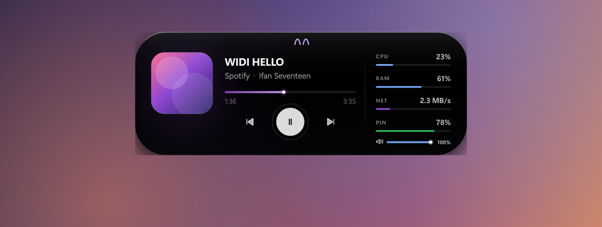
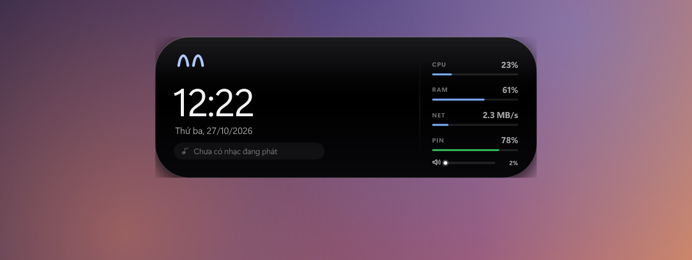
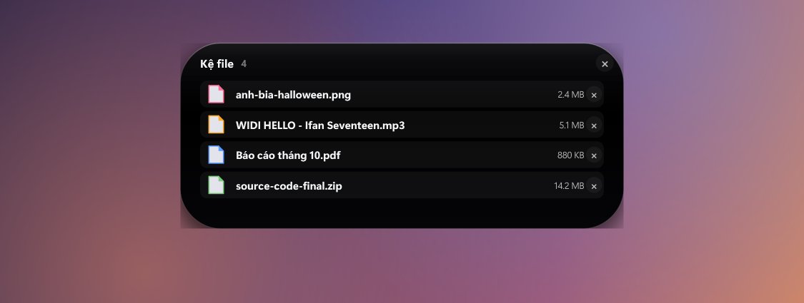
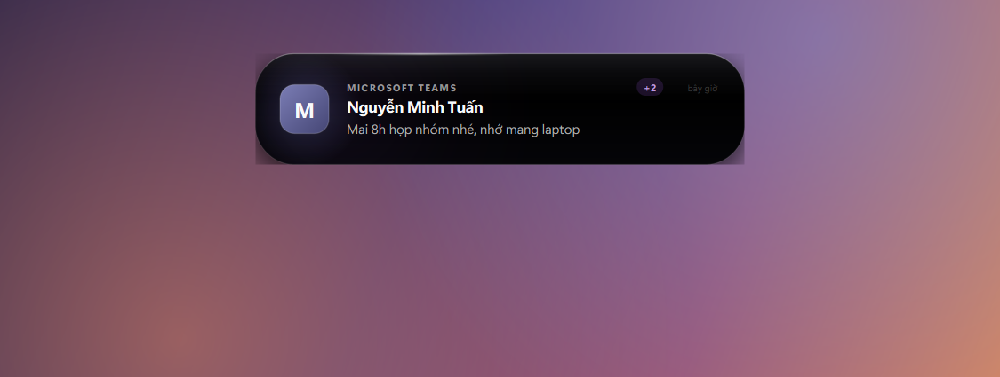
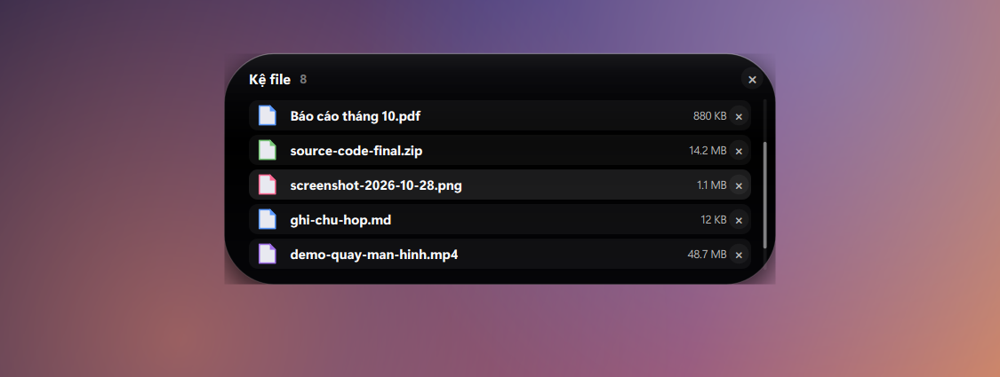

# Dynamic Island cho Windows

Viên đảo nổi ở giữa mép trên màn hình: nhạc đang phát, thông báo Windows, đồng hồ và thông số máy.
Toàn bộ code chạy trên máy bạn — không tải exe lạ, không gọi mạng, không cài service.

| Thu gọn — đang phát | Thu gọn — rảnh rỗi |
|---|---|
|  |  |

| Mở rộng — nhạc | Mở rộng — đồng hồ |
|---|---|
|  |  |

| Thông báo | Kệ file (kéo-thả) |
|---|---|
|  |  |

| Thông báo còn xếp hàng (`+2`) | Kệ dài: tự cuộn, thanh cuộn bên phải |
|---|---|
|  |  |

## Thiết kế

Lấy cảm hứng từ mấy app notch kiểu macOS (Notchy, Nusa): nền **đen tuyền** thay vì xám, viền
sáng 1px, và **đôi mắt linh vật** — thứ làm nó sống hơn hẳn một widget thông thường.

- **Mắt**: chớp ngẫu nhiên 2–6 giây, nhìn theo con trỏ khi rê chuột lên, cong `^ ^` khi có nhạc,
  lim dim ngủ (kèm chữ `z` bay lên) sau ~35 giây không có gì.
- **Nền**: đen `#000` pha chút xanh ở đỉnh, cộng quầng sáng rất nhẹ lấy màu từ bìa album.
- **Chữ**: tên bài dài tự chạy ngang, mờ dần ở mép phải thay vì cắt cụt.
- **Bung/thu**: 360 ms `OutExpo` cho kích thước; nội dung trượt lên ~7 px và mờ dần vào.
- **Sóng nhạc**: 5 thanh mảnh, hai tần số lệch pha nên nhịp không đều như thật; màu nhấn lấy từ bìa đĩa.
- **Nút điều khiển**: play tròn trắng đặc + glyph đen (kiểu Apple Music), có nhịp lan toả khi đang phát;
  prev/next có quầng tròn.
- **Khi đang phát nhạc**: vệt sáng chạy dọc mép trên, quầng màu nhấn sau bìa "thở" chậm, chấm tiến
  trình nhấp nháy. Tất cả chạy theo thời gian thực (dt) nên tốc độ không đổi dù fps dao động.

## Cần gì

- Windows 10 1809+ hoặc Windows 11
- Python 3.11 trở lên (chỉ cần cho lần cài đầu)

## Cài

```
git clone https://github.com/tuankhongbietcode/dynamic-island-windows
cd dynamic-island-windows
setup.bat
```

`setup.bat` tạo `.venv`, cài thư viện, kiểm tra lại rồi **tự khởi động island** luôn.
Lần sau chỉ cần bấm `start-island.vbs` (không có cửa sổ đen nào hiện ra).

Nếu bạn đã có sẵn môi trường Python khác và không muốn tạo `.venv`, tạo file
`python-path.txt` ở thư mục gốc, dòng đầu ghi đường dẫn đầy đủ tới `pythonw.exe`.
`start-island.vbs` tự dò theo thứ tự: `.venv` → `python-path.txt` → `py -3` → `pythonw` trong PATH.

Muốn tự khởi động cùng Windows: chuột phải lên island → **Khởi động cùng Windows** (hoặc bật trong menu tray).

| Thao tác | Kết quả |
|---|---|
| Đưa chuột lên island | Bung ra: nhạc + thông số CPU/RAM/NET/PIN |
| Bấm chuột trái | Ghim mở rộng (bấm lần nữa để thu lại) |
| Kéo chuột | Di chuyển island, tự bám lại mép trên |
| Trượt/click lên thanh âm lượng | Chỉnh âm lượng hệ thống; click icon loa để tắt/bật tiếng |
| Kéo file vào island | Lưu tạm vào kệ file (SHELF) |
| Lăn chuột trên kệ | Cuộn danh sách khi kệ có hơn 5 file (kèm thanh cuộn bên phải) |
| Click file trên kệ | Mở file bằng ứng dụng mặc định |
| Kéo file trên kệ ra ngoài | Đẩy file sang app khác (Explorer, chat…) |
| Click dấu × trên kệ | Xoá file khỏi kệ |
| Click thẻ thông báo | Bỏ qua thông báo này, hiện ngay cái kế tiếp trong hàng đợi |
| Chuột phải | Menu: ghim, kệ file, về giữa màn hình, gửi thông báo thử, thoát |
| Icon ở khay hệ thống | Menu đầy đủ: luôn trên cùng, chế độ tĩnh, tự động tĩnh, kệ file, khởi động cùng Windows |

Khi thu nhỏ:

- **Có nhạc** → bìa album + sóng nhạc + tên bài + đôi mắt ở cuối.
- **Không có nhạc** → đôi mắt + giờ + thứ/ngày.

Khi có thông báo Windows → island tự bung thành thẻ thông báo 6 giây rồi thu lại.
Thông báo tới khi đang hiện cái khác (hoặc lúc bạn đang mở panel) **không bị mất**: nó xếp hàng,
thẻ hiện chip `+N` và tự lần lượt hiện tiếp — bấm vào thẻ để bỏ qua cái đang xem.

## Chế độ tĩnh & Tối ưu CPU

Đảo tự động **đông cứng** khi bạn chuyển sang làm việc ở ứng dụng khác — mắt ngừng chớp, sóng nhạc dừng, chỉ còn đồng hồ và hình dáng viên đảo. Điều này giúp CPU gần như không tốn tài nguyên khi bạn tập trung vào việc chính.

- **Tự động tĩnh khi dùng app khác** (mặc định BẬT): đảo phát hiện khi một cửa sổ ứng dụng thật chiếm foreground → tự động đứng yên. Quay lại desktop hoặc rê chuột lên đảo → hoạt cảnh tiếp tục.
- **Chế độ tĩnh thủ công** (mặc định TẮT): bật trong khay hệ thống để đảo luôn đứng yên, chỉ vẽ lại khi phút đổi hoặc bạn rê chuột vào.

Nhịp vẽ **tự thích ứng theo cả trạng thái lẫn tốc độ máy** — đây là phần quan trọng nhất
để máy yếu vẫn mượt:

| Tình huống | Nhịp | Ghi chú |
|---|---|---|
| Rê chuột vào đảo | 60 fps | máy chậm tự hạ còn 30 fps |
| Đang phát nhạc, đảo đang hiện | 30 fps | 20 fps nếu máy chậm |
| Đang phát nhạc nhưng bạn ở app khác | 15 fps | vẫn "thở" nhẹ, không đứng hình |
| Rảnh ở desktop (không nhạc) | 15 fps khi cần, còn lại ~2 fps | đủ để mắt chớp |
| Đang làm việc ở app khác, không nhạc | ~2,5 fps | gần như không tốn CPU |

Máy nhanh hay chậm được phát hiện bằng cách đo thời gian vẽ thật của từng khung
(trung bình trượt). Ngưỡng: khung dưới 6 ms mới chạy 60 fps.

Đo trên máy tham chiếu, tính **% của một nhân CPU**, đã gồm cả các thread nền
(nhạc, thông báo, thông số):

| Trạng thái | Trước tối ưu | Sau tối ưu |
|---|---|---|
| Rảnh ở desktop, không nhạc | 7,2 % | **1,6 %** |
| Đang phát nhạc, bạn làm việc ở app khác | 27 % | **11,7 %** |
| Rê chuột, panel mở rộng | 45 % | **31 %** |

Máy khác sẽ ra số khác, nhưng cơ chế thích ứng tự chọn mức fps vừa sức: máy càng chậm
càng hạ nhịp, nên không bao giờ rơi vào cảnh cố 60 fps rồi giật.

## Thông báo Teams / Outlook / mail

Mọi thứ hiện thành **toast của Windows** đều vào island: Microsoft Teams, Outlook, Gmail trên
trình duyệt, Zalo, Discord, Telegram, Slack… Avatar tự lấy màu thương hiệu của app.

Muốn kiểm tra nhanh: chuột phải lên island → **Gửi thông báo thử**.

Nếu app đó không hiện trong island, kiểm tra theo thứ tự:

1. **Windows → Settings → System → Notifications**: app đó phải đang bật, và không ở chế độ
   "chỉ hiện banner" (nếu chỉ banner thì thông báo không vào Action Center nên không đọc được).
2. Đang bật **Focus Assist / Do Not Disturb** thì Windows không tạo toast → island không thấy gì.
3. App dùng cửa sổ thông báo tự vẽ (không phải toast) thì không đọc được — chỉ đọc được toast chuẩn.
4. Lần đầu chạy, Windows hỏi quyền truy cập thông báo → phải bấm **Đồng ý**.

## Cái gì hoạt động

- **Nhạc**: đọc Windows SMTC — Spotify, Apple Music, YouTube/Chrome/Edge/Brave, Media Player…
  bất kỳ app nào có trong bảng điều khiển media của Windows. Có play/pause, chuyển bài, thanh
  tiến trình, thời lượng, ảnh bìa, và **màu nhấn lấy từ ảnh bìa**.
- **Thông báo**: đọc toast của Windows qua `UserNotificationListener`.
- **Thông số**: CPU, RAM, tốc độ mạng xuống, phần trăm pin (kèm tia sét khi đang sạc).
- **Âm lượng hệ thống**: thanh trượt trong panel mở rộng, kéo để chỉnh master volume (qua
  `pycaw` / Core Audio), click icon loa để tắt/bật tiếng. Tự cập nhật nếu bạn chỉnh âm lượng
  ở nơi khác.
- **Kệ file kéo-thả (SHELF)**: kéo file từ Explorer hay bất kỳ đâu thả vào island để lưu tạm;
  click để mở bằng app mặc định, kéo ngược ra để đẩy file sang app khác, dấu × để xoá. Số lượng
  file đang lưu hiện thành huy hiệu nhỏ trên island khi thu gọn. Mở/đóng kệ qua chuột phải hoặc
  icon khay hệ thống. Kệ **nhớ qua các lần mở app** (lưu ở `%APPDATA%\DynamicIsland\shelf.json`),
  file nào đã bị xoá/di chuyển khỏi đĩa thì tự rơi khỏi kệ; quá 5 file thì cuộn bằng con lăn.
- **Thông báo xếp hàng**: nhiều thông báo tới dồn dập thì hiện lần lượt từng cái (tối đa 3 cái chờ),
  không cái nào bị cái sau đè mất.
- **Đồng hồ**: giờ ở trạng thái thu gọn, đồng hồ lớn + thứ/ngày khi mở rộng mà không có nhạc.

## Cấu hình

Lưu ở `%APPDATA%\DynamicIsland\config.json` (vị trí island, trạng thái ghim, luôn trên cùng).
Danh sách file trên kệ nằm cạnh đó trong `shelf.json`. Xoá file này để về mặc định.
Cả hai được ghi kiểu nguyên tử (ghi file tạm rồi `os.replace`) nên tắt máy đột ngột không làm hỏng file.

## Gỡ

1. Chuột phải lên island → **Thoát**.
2. Tắt "Khởi động cùng Windows" trong menu tray.
3. Xoá thư mục này và `%APPDATA%\DynamicIsland`.

## Ghi chú kỹ thuật

- Cửa sổ là `QWidget` frameless + `WA_TranslucentBackground`, toàn bộ vẽ bằng `QPainter`
  (bo góc, gradient, bóng đổ blur, icon vector) nên không có file ảnh nào.
- Hoạt cảnh bung/thu là `QVariantAnimation` nội suy đồng thời kích thước và bán kính góc
  (360 ms, OutExpo).
- Ba lớp tĩnh đều được cache thành `QPixmap` và chỉ blit lại mỗi khung: **nền + bóng đổ**,
  **bìa nhạc đã bo góc + sheen + viền** (`_art_tile_for`), và **font/metrics**. Nhờ vậy phần vẽ
  thật chỉ còn ~2 ms/khung cho panel mở rộng.
- Clip nội dung dùng `setClipRect` chứ không dùng clip theo `QPainterPath` cong — clip path bật
  khử răng cưa từng pixel, đắt hơn nhiều lần mà nhìn không khác gì.
- **Chi phí thật nằm ở Windows, không phải ở code vẽ**: mỗi khung, cửa sổ trong suốt
  (`WA_TranslucentBackground`) phải upload lại toàn bộ mặt cửa sổ, tốn ~4–10 ms tuỳ diện tích.
  Vì thế cách tối ưu hiệu quả nhất là **vẽ ít khung hơn khi không cần**, chứ không phải vẽ nhanh hơn.
- **Nhịp tick thích ứng** (`_set_tick_rate`): 16 ms `PreciseTimer` khi có hoạt cảnh, 66 ms khi rảnh
  ở desktop, 400 ms `CoarseTimer` khi đông cứng. Timer 16 ms luôn bật sẽ buộc Windows giữ độ phân
  giải timer ở 1 ms và ngăn CPU vào trạng thái nghỉ — đó là lý do bản cũ tốn pin vô ích.
- **Nhịp quét thông báo tự điều chỉnh theo chi phí đo được.** Windows không cho app chạy trực tiếp
  đăng ký event `add_notification_changed` (trả `Element not found`), nên phải quét
  `get_notifications_async`. Một lần quét tốn 30 ms (ít thông báo) tới 600 ms (rất nhiều thông báo),
  và chi phí đó tỉ lệ với số thông báo đang có trong Action Center. Vì vậy code đo thời gian từng
  lần quét rồi đặt nhịp = `thời gian quét / 35`, kẹp trong 2–12 giây — tức phần này luôn chỉ dùng
  ~3,5 % một nhân, bất kể người dùng giữ bao nhiêu thông báo. Nếu Windows có bắn event (một số bản
  có hỗ trợ) thì tự chuyển sang chế độ event và gần như không tốn gì.
- **Không để thread nền giết UI**: `pythonw` không có `stdout/stderr`, nên mọi chỗ bắt lỗi trong
  worker đi qua `debug.log_exc()` (không bao giờ tự ném lỗi). `main.py` còn trỏ `stdout/stderr`
  vào `%APPDATA%\DynamicIsland\island.log` khi chạy không console — vừa an toàn vừa có log để gỡ.
- **Chế độ tĩnh / tối ưu foreground**: theo dõi cửa sổ đang chiếm foreground qua `GetClassNameW`
  (mỗi 400 ms). Nếu là ứng dụng thật (không phải desktop/traybar) → đông cứng, chỉ vẽ lại khi
  phút đổi hoặc rê chuột vào.
- `media.py` và `notify.py` chạy trong `QThread` riêng, mỗi thread có asyncio loop cho WinRT;
  giao tiếp với UI qua `Signal`.
- Chạy `python main.py` để xem log; `python snapshot.py` để xuất ảnh từng trạng thái vào `preview/`.
- Cần soi kỹ sự kiện chuột / lệnh media / chuyển trạng thái: đặt `ISLAND_DEBUG=1` rồi chạy,
  log ghi vào `%APPDATA%\DynamicIsland\debug.log`.

## Giấy phép

MIT — xem [LICENSE](LICENSE).
